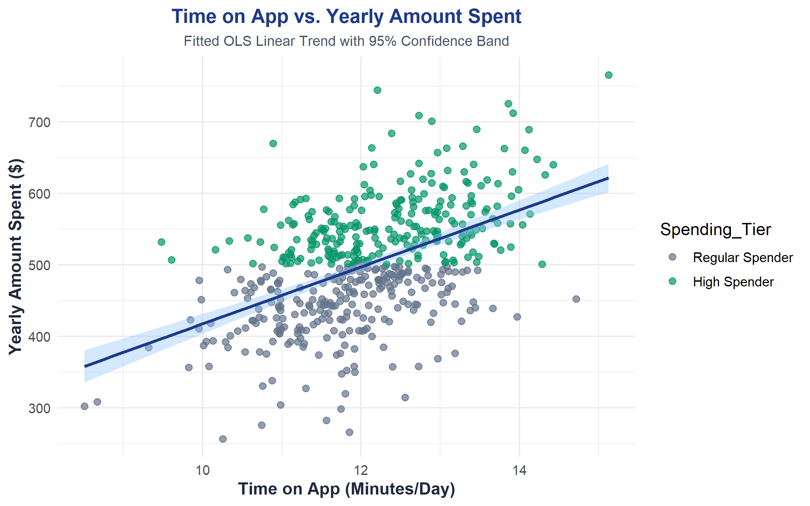
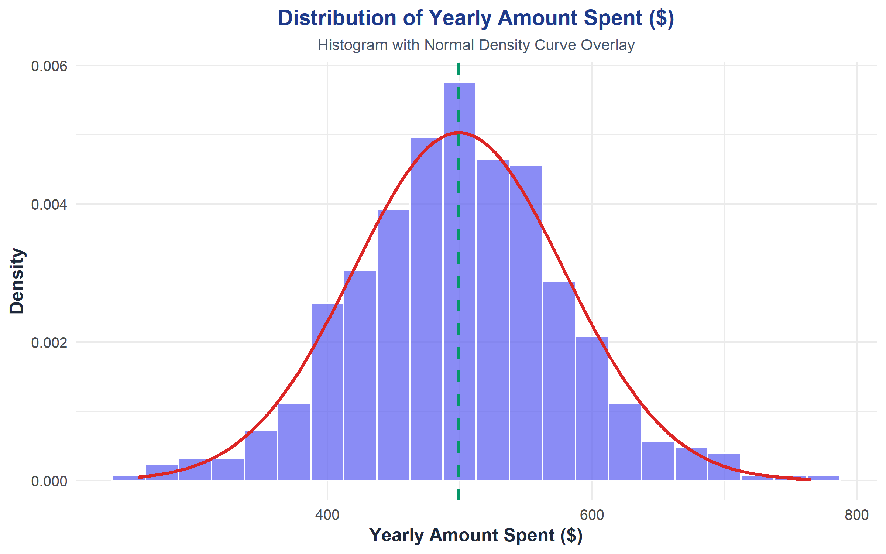
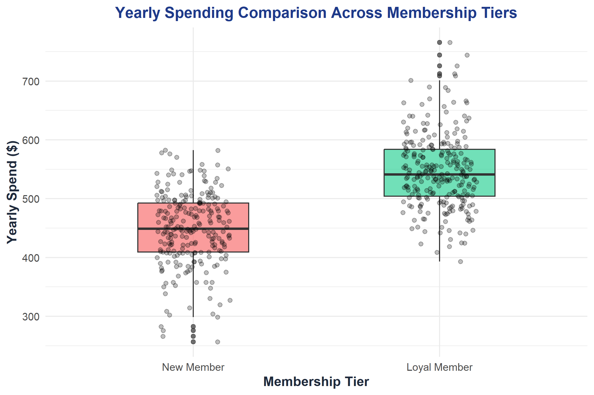
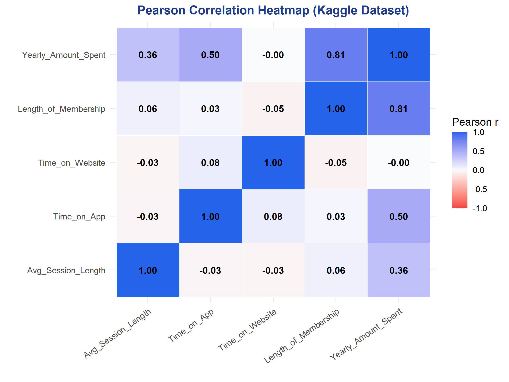
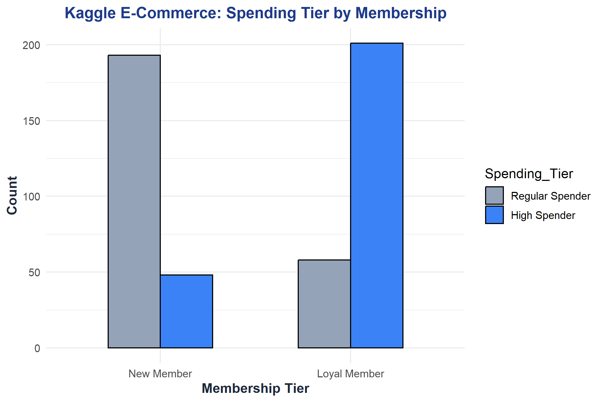
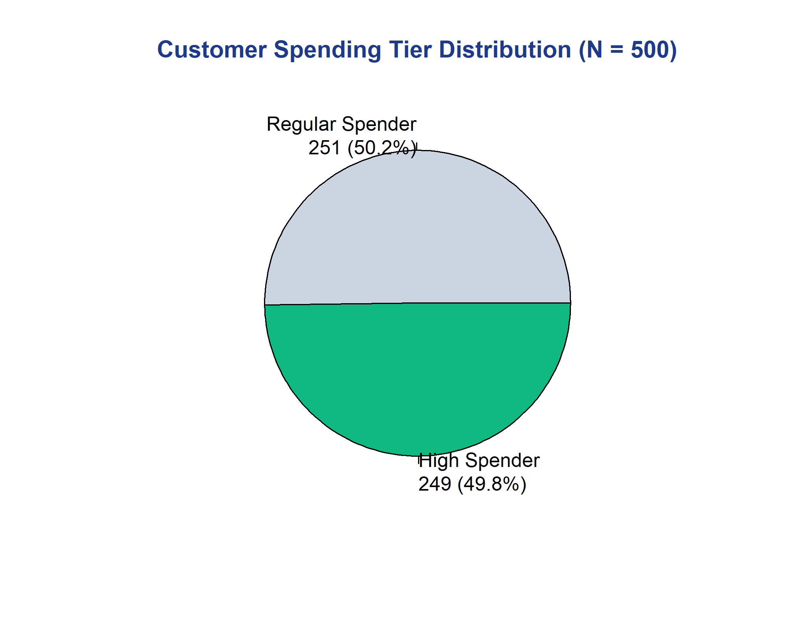
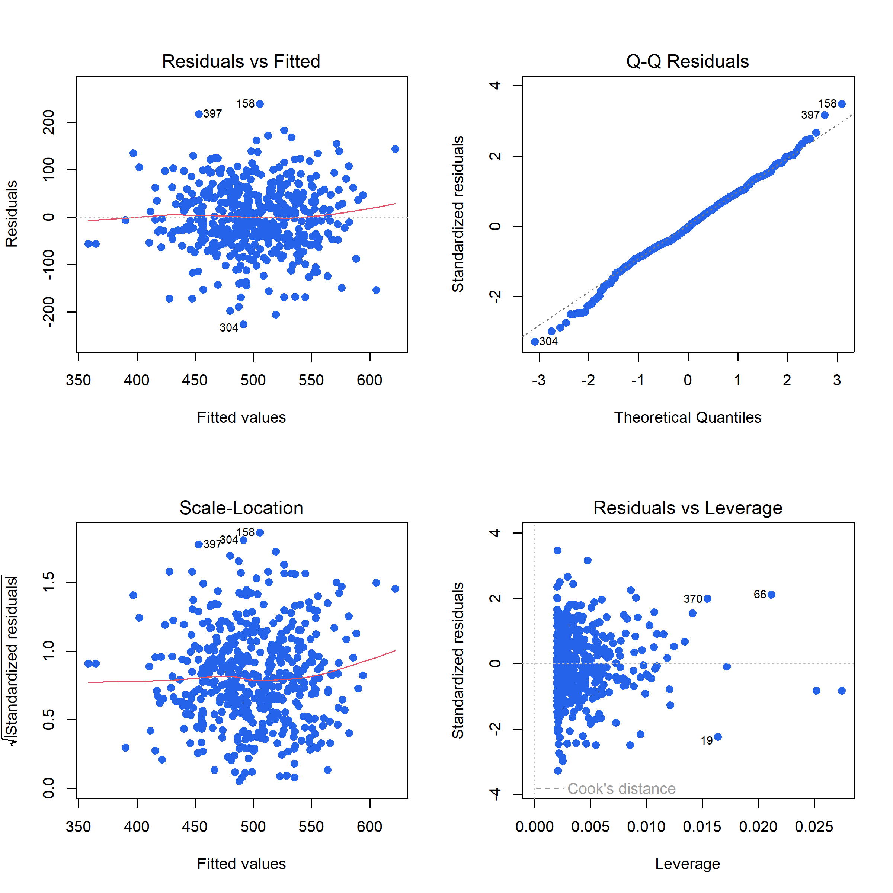

# 📊 Statistical Analysis of E-Commerce Customer Spending Behavior Using R

<p align="center">
  
  
  
  
  
</p>

---

## 📌 Project Overview
* **Student Name:** Arpit Saxena
* **UID / Roll No:** 26MCD10006
* **Class & Section:** MCA (Data Science) – 26MCD-1 (A)
* **Semester:** 1st Semester (2026–2027)
* **Institution:** University Institute of Computing (UIC), Chandigarh University, Mohali
* **Faculty Mentor:** Ms. Tanisha (E20679)

This mini-project presents an empirical, statistically rigorous case study investigating the purchasing patterns of **$N = 500$ consumers** from the **official Kaggle E-Commerce Customers dataset** using the **R programming language** and **RStudio**. 

The entire statistical pipeline is implemented within a single, lightweight script ([`run_project.R`](run_project.R)) of **191 lines**, adhering strictly to university constraints.

---

## 📁 Repository Structure

```
Ecommerce_Customer_Analytics_Project/
├── run_project.R                          # Master executable script (191 lines)
├── README.md                              # Project documentation & GitHub overview
├── .gitignore                             # Ignores R session caches (.RData, .Rhistory)
├── Ecommerce_Customer_Analytics_Project.Rproj # RStudio Project file
├── data/
│   └── ecommerce_customers.csv            # Official Kaggle dataset (500 records)
├── plots/                                 # 7 High-resolution charts (300 DPI)
│   ├── 01_membership_tier_bar.png
│   ├── 02_spending_tier_pie.png
│   ├── 03_yearly_spending_histogram.png
│   ├── 04_spending_by_tier_boxplot.png
│   ├── 05_app_time_vs_spending_scatter.png
│   ├── 06_correlation_heatmap.png
│   └── 07_regression_diagnostic_plots.png
└── Report/                                # Official University Project Reports
    ├── Mini_Project_Report_Arpit_Saxena.docx # Complete Word format report
    ├── Mini_Project_Report_Arpit_Saxena.pdf  # Final compiled PDF report
    └── front page report R.pdf               # Signed cover page
```

---

## 📈 Dataset Overview (Kaggle Benchmark: N = 500)

| Variable | Type | Range | Description |
| :--- | :--- | :--- | :--- |
| `Avg_Session_Length` | Numeric | 29.53 – 36.14 mins | Average in-store / styling advice duration |
| `Time_on_App` | Numeric | 8.51 – 15.13 mins | Daily minutes spent browsing mobile app |
| `Time_on_Website` | Numeric | 33.91 – 40.01 mins | Daily minutes spent on desktop website |
| `Length_of_Membership` | Numeric | 0.27 – 6.92 years | Customer relationship duration (years) |
| `Yearly_Amount_Spent` | Numeric | $256.67 – $765.52 | Total annual expenditure in USD ($Y$) |
| `Spending_Tier` | Factor | Regular / High | High Spender (≥ $500) vs. Regular (< $500) |
| `Membership_Tier` | Factor | New / Loyal | Loyal Member (≥ 3.5 yrs) vs. New (< 3.5 yrs) |

---

## 🔬 Key Statistical Results & Hypotheses

### 1. Descriptive Statistics ($N = 500$)
* **Mean Yearly Spend ($\bar{X}$):** **$499.31** (Median = $498.89, SD = $79.31, IQR = $104.28)
* **Mean Daily Time on App:** **12.05 mins** (SD = 0.99 mins)
* **Customer Segment Split:** 50.2% Regular Spenders ($n=251$) vs. 49.8% High Spenders ($n=249$)

### 2. Pearson Correlation Matrix ($r$)
* **Time on App vs. Yearly Spend:** **$r = 0.4993, t = 12.86, p = 6.91 \times 10^{-33}$** (Statistically significant positive correlation)
* **Length of Membership vs. Yearly Spend:** **$r = 0.8093, p < 0.001$** (Strongest overall revenue driver)
* **Time on Website vs. Yearly Spend:** **$r = -0.0026, p = 0.954$** (Zero linear correlation; desktop browsing is exploratory)

### 3. Inferential Hypothesis Testing (t-Tests)
* **One-Sample t-Test against $500 Benchmark:**
  $$H_0: \mu = 500 \quad \text{vs.} \quad H_1: \mu \ne 500$$
  *Result:* $t = -0.1934, df = 499, p\text{-value} = \mathbf{0.8467} > 0.05$.
  *Conclusion:* **Fail to Reject $H_0$**. The cohort mean of $499.31 is statistically consistent with the $500 target.
* **Two-Sample Independent t-Test (Membership Tiers):**
  $$H_0: \mu_{\text{Loyal}} - \mu_{\text{New}} = 0 \quad \text{vs.} \quad H_1: \mu_{\text{Loyal}} - \mu_{\text{New}} \ne 0$$
  *Result:* $t = -17.48, df = 498, p\text{-value} = \mathbf{1.00 \times 10^{-53}} < 0.001$.
  *Conclusion:* **Reject $H_0$**. Loyal Members spend an average of **$546.45**, while New Members spend **$448.65** (an average premium of **+$97.80/year**).

### 4. Simple Linear Regression Modeling (OLS)
$$\mathbf{\widehat{\text{Yearly\_Amount\_Spent}} = 19.21 + 39.83 \times \text{Time\_on\_App}}$$

* **Slope ($\hat{\beta}_1 = 39.83, p < 0.001$):** Every additional minute spent on the mobile app daily yields an expected **+$39.83 in annual spending**.
* **Goodness-of-Fit:** $R^2 = 0.2493$, Adjusted $R^2 = 0.2478$, $F(1, 498) = 165.41, p < 0.001$.
* **Residual Normality:** Shapiro-Wilk test $W = 0.9946, p\text{-value} = \mathbf{0.0770} > 0.05$. Residuals follow a normal Gaussian distribution, satisfying Gauss-Markov OLS assumptions.

---

## 📊 Visualizations

<p align="center">
  
  
</p>
<p align="center">
  
  
</p>
<p align="center">
  
  
</p>
<p align="center">
  
</p>

---

## 🚀 How to Run the Project

### Using Terminal / PowerShell:
```powershell
# Clone the repository
git clone https://github.com/arpitsaxenawork/Ecommerce_Customer_Analytics_Project.git
cd Ecommerce_Customer_Analytics_Project

# Run the complete analysis (191 lines)
& "C:\Program Files\R\R-4.6.1\bin\Rscript.exe" run_project.R
```

### Using RStudio:
1. Open `Ecommerce_Customer_Analytics_Project.Rproj` in RStudio.
2. In the console, execute:
   ```R
   source("run_project.R")
   ```
*All calculations, tables, test statistics, and regression equations will print live to your terminal screen, and all 7 charts will be updated in `plots/`.*

---

## 📜 Academic Certification & Report
The complete formatted academic report is available in the [`Report/`](Report/) directory:
* **[Word Document Report](Report/Mini_Project_Report_Arpit_Saxena.docx)**
* **[Compiled PDF Report](Report/Mini_Project_Report_Arpit_Saxena.pdf)**

